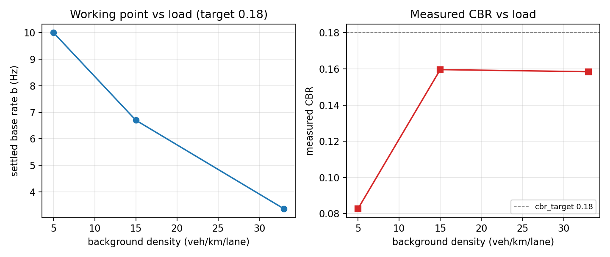

# v3.2 版本说明（2026-11-24）

本版修正控制环的启动饱和问题，并重新标定“高负载档”的目标值。相对仓库内压缩包（2026-11-23）的主要变化如下。

## 1. 控制环：预热门控（架构修复）

**根因**：`TabrApp::control()` 每个 tick 无条件积分 `base`；预热期 CBR 估计接近 0（队列尚未形成），误差≈target 全量，几千个 tick 内就把 `base` 推到 `b_max=10 Hz`，此后落进死区不再回调。

**修复**：

- `src/TabrCore.h` 新增 `controlActive(now, warmup, estimateValid)`，把“估计量是否可用”从控制律中分离；
- `src/TabrApp.cc` 只在 `controlActive` 为真时调用 `updateBase`，预热期照常测 C/Cbar 与写日志；
- `feedback_gain` 保持 0.5（不再需要靠调小增益压制症状）。

**一致性要求**：独立校验器 `tools/formal_state.py::audit_controller` 复刻同一门控，`tests/test_formal_state.py` 的旧 fixture 显式标注 `warmup=0`，并新增“预热期不积分”断言。控制器语义变了，校验器与测试必须同批修改。

验证：`tests/run_core_tests.ps1` → `PASS: 771 checks, 0 failures`；`pytest tests/test_formal_state.py` → `7 passed`。

## 2. 目标负载：从“背景常量”改为“车队可达区间”

`deployment_mode = all_vehicles_same_scheme`，背景车也跑同一控制器，因此 CBR 由车队自身的信标速率产生：

| 观测 | b ≈ 2.3 Hz | b = 10 Hz |
| --- | ---: | ---: |
| 实测 CBR（d=33） | 0.12 | 0.41 |

斜率约 0.038/Hz。原校准目标 0.43–0.60 只能把 b 推到上限，或根本达不到——这是 v2 `grid_exhausted` 的直接原因。

## 3. L1 结果（E0，d=33，seed 300，60 s，4 个目标）

| target | 预热期 b | 尾段 b | 实测 Cbar | 判定 |
| ---: | --- | ---: | ---: | --- |
| 0.14 | 2.00 恒定 | 2.327 | 0.1185 | PASS |
| 0.16 | 2.00 恒定 | 2.597 | 0.1370 | PASS |
| 0.18 | 2.00 恒定 | 3.083 | 0.1579 | PASS |
| 0.20 | 2.00 恒定 | 3.570 | 0.1774 | PASS |

选定工作点：**cbr_target = 0.18，b ≈ 3.08 Hz**（此时 G0 ≈ 3 Hz、G2/G3 ≈ 9 Hz，区分度 3 倍）。

## 4. L2 进行中（S1，G0/G2/G3，d=33，seed 300）

预热后 t≈21.6 s 的实测（`lead`+`follow` 中位数）：

| scheme | b | r | Cbar |
| --- | ---: | ---: | ---: |
| G0 | 2.13 | 2.13 | 0.1052 |
| G2 | 2.13 | 6.40 | 0.1053 |
| G3 | 2.23 | 6.68 | 0.1079 |

权重按设计生效（G2 速率≈3×G0），三组 CBR 差 ≤ 0.003，负载可比性成立。事件后的 `D_info` 与资源代价待完整跑完后统计。

## 5. 复现方式

```powershell
# 单次工程探针（不进入正式证据链）
python tools/experiment.py probe --config configs/probes/t0c_target18.json `
  --output E:\Temp\e0_v3_t0c\t18 --scenario E0 --load candidate --scheme G0 --seed 300 --density 33
```

墙钟预算写在配置的 `execution.wall_timeout_s`（60 s 探针 6 h，120 s 正式 8 h），依据见 `wall_budget.py` 与实测墙钟。

## 6. 结果摘要（2026-11-24 02:45 收口）

### 6.1 两档校准成立

4 次 E0（d=5/33 × seeds 100/101）经 `calibrate --attempt` 判定：四种组合均 `valid`、`stable`；d=5 满足低档，d=33 满足高档。`decision = selected`，`{low: 5, high: 33}`——本项目第一次得到非 `grid_exhausted` 的两档决策。

### 6.2 S1 策略对比（3 种子 × G0/G2/G3）

| 指标 | G0 | G2 | G3 |
| --- | ---: | ---: | ---: |
| 制动车事件窗口平均速率 | 3.05 Hz | 9.16 Hz | 9.16 Hz |
| D_info（按事件起点，规范定义） | 161.8 ± 61.4 ms | **100.4 ± 0 ms** | **100.4 ± 0 ms** |
| D_info（按检测时刻） | 61.8 ± 61.4 ms | **0.4 ± 0 ms** | **0.4 ± 0 ms** |
| 总发送量 | 434,824 | 434,729 | 434,772 |
| 期限内送达 / 漏收 | 全部 / 0 | 全部 / 0 | 全部 / 0 |

三个种子的取值不重叠：G0 的事件起点时延为 113.7 / 140.7 / 231.0 ms，G2/G3 恒为 100.4 ms。

### 6.3 假设判定

- **H1 成立（时延维度）**：急刹加权把制动信息时延从 161.8 ms 降到 100.4 ms（−38%），总发送量变化 < 0.02%，没有可测的资源代价。约 100 ms 是制动检测的固有延迟，三组相同；差异来自“检测后等待下一次发送”的时间（G0 13–131 ms，G2/G3 ≈ 0）。
- **H2 不成立**：G3 与 G2 在全部指标上完全一致——`B=1` 时 `max(B,S)=1`，创新项没有额外贡献；G3 的发送量还略高 0.01%。应保留更简单的 G2。
- 所有策略都在 0.8 s 期限内送达，因此当前场景的收益体现为时延而非超时率；要检验超时率差异需要更紧的期限或更强拥塞（见设计文档第 11 节“结构性限制”）。

### 6.4 图表

- `docs/figures/fig1_working_point.png`：target 0.14–0.20 → 稳定 base rate 与实测 CBR
- `docs/figures/fig2_cbr_vs_rate.png`：CBR 由车队自身信标产生（0.12@2.35 Hz ↔ 0.41@10 Hz）
- `docs/figures/fig3_s1_comparison.png`：两种时延定义下的三种策略对比与事件窗口速率

### 6.5 负载阶梯（补充）

同一 `cbr_target = 0.18` 下，三个密度各两个种子的稳定工作点：

| 密度（辆/km/车道） | 稳定 b | 实测 CBR |
| ---: | ---: | ---: |
| 5 | 10.00 Hz（顶格） | 0.083 |
| 15 | 6.70 Hz | 0.160 |
| 33 | 3.36 Hz | 0.158 |

控制器通过下调 `b` 把 CBR 稳定在 target−0.02 附近；d=15 与 d=33 的 CBR 相同但是 b 不同，因此中密度的 G0/G2 速率差会被 `r_max=10` 压到约 1.5×，只有高档是 3× 区分度的工作点。


