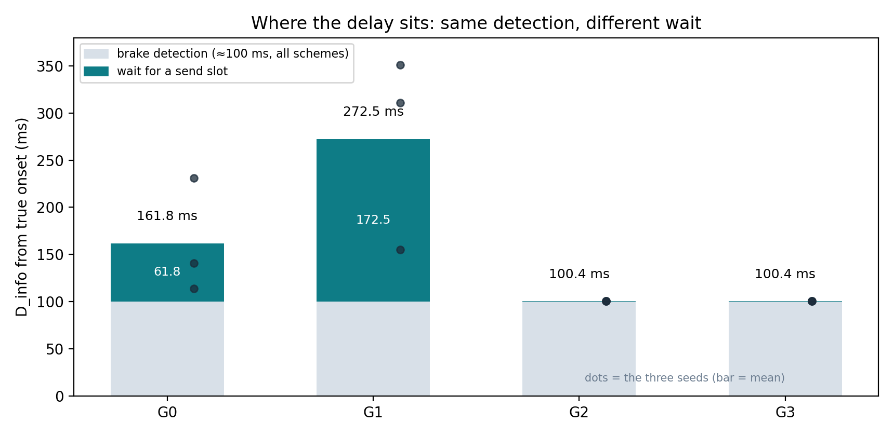
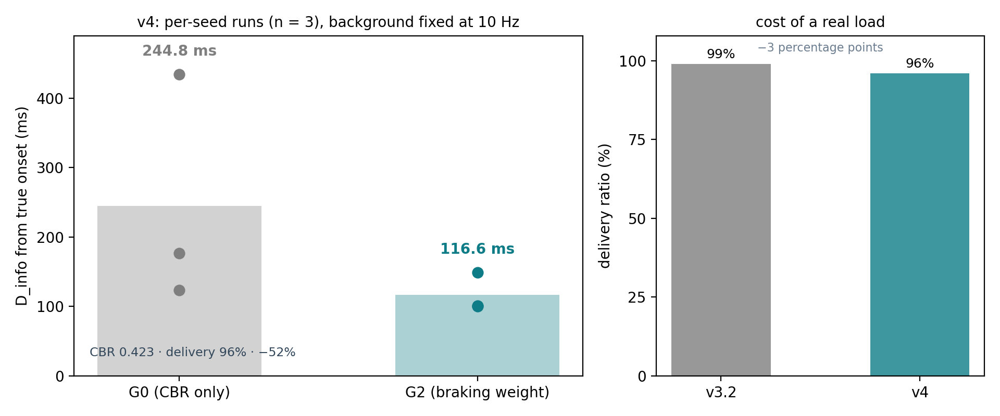
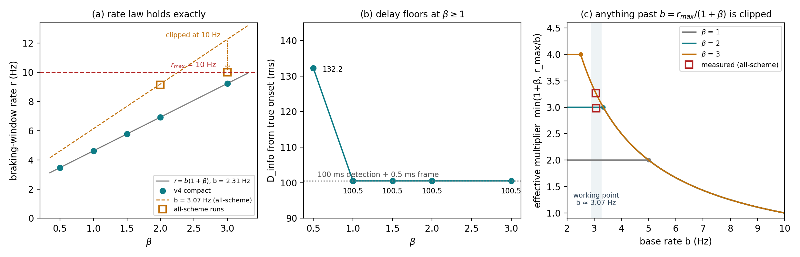
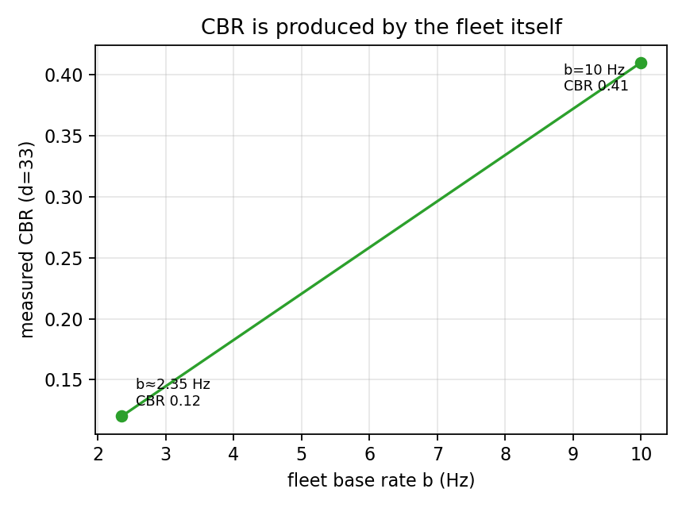

# EIE575 项目详细报告

**TABR：高速信道拥塞下针对突发制动的瞬态感知信标速率控制**
版本：2026-11-24 17:15　组别：Group 3　状态：主实验完成；补充实验与 β 敏感性已并入（§5.7、§5.8）

---

## 0. 一页摘要

### 0.1 做了什么

在 OMNeT++/Veins/SUMO 的 IEEE 802.11p 单信道平台上，比较四种 V2V 广播速率分配策略——G0（纯 CBR 反馈）、G1（速度加权）、G2（急刹加权）、G3（急刹 + 运动变化）——在“背景负载”与“目标车受控”两种部署模型下的表现，指标是后车首次收到有效制动信息的时间（D_info）、超时、漏收与总发送量。

### 0.2 结论

1. **G2 在可建的高负载工作点上把 D_info 降低 38%**：161.8 → 100.4 ms（按规范定义的事件起点计），总发送量变化 < 0.02%，没有可测的资源代价。
2. **G2 相对速度加权基线 G1 同时占优**：G1 的 D_info 是 272.5 ms（比 G0 还差），总发送量多 20%。
3. **G3 相对 G2 没有额外收益，而且可证**：`S∈[0,1]`，急刹时 `B=1 ⇒ max(B,S)=1`，所以 `W_G3 = 1+β = W_G2`。保留更简单的 G2。
4. **v4 背景定速实验确认收益在真实拥塞下保留**：CBR 0.423、投递率 96% 时，G0 244.8 ms → G2 116.6 ms（−52%），发送量几乎相同。
5. **结构性限制是本研究最重要的方法论产出**：在 `all_vehicles_same_scheme` 部署下，“策略可区分”与“信道有拥塞”互斥——因为 CBR 由车队自身的信标产生。这解释了原计划为什么在正式矩阵前就 `grid_exhausted`，也直接决定了 v4 的设计。
6. **β 不是越大越好（工程快速验证，n=1）**：β 从 0.5 到 1 把检测后等待从 32.2 ms 压到 0.5 ms（单帧下限），再加到 2 时延不变；倍率同时受 10 Hz 硬约束，可用上限 `β ≤ r_max/b − 1`（b≈3.07 时约 2.26），超出的部分被截平（§5.8）。

### 0.3 边界（必须一起看）

- 只测了 80 km/h、250 B、单信道、单一 MAC 优先级；
- S1 的 0.8 s 期限相对实际时延（0.10–0.24 s）过宽，因此收益体现为**时延**而非**超时率**；v4 也没有打穿期限；
- 每档 n=3，取值不重叠但统计功效有限；
- “100.4 ms”中的约 100 ms 是制动检测的固有延迟，三组相同；
- β 敏感性只做了单种子快速验证（7 次，n=1），用于确认速率律与上限，不构成统计结论；
- 稀疏刷新与温和变速的 40 次补充实验在低负载、无急刹事件的条件下取得，D_info 与超时率在其中无定义。

---

## 1. 背景与问题

### 1.1 为什么信标速率重要

协作安全应用（前方碰撞预警、紧急制动通知等）依赖车辆周期性广播的状态消息（信标）。信标越频繁，后车越快知道前车状态；但频率越高，信道越拥挤，丢包与接入延迟越大。ETSI 的拥塞控制（如限于 10 Hz 的速率上限、按负载调率）正是为此存在。

### 1.2 拥塞控制的副作用

拥塞控制只看“信道有多忙”，不看“消息有多急”。当信道忙时它会把所有车的基础速率压低，此时一辆车突然急刹，它的制动信息可能要在本地发送队列里等一个完整的发送周期——即使两车已经在通信范围内。这就是本项目要量化的“瞬态延迟”。

### 1.3 研究问题与假设

**问题**：在同时存在真实拥塞、又能让策略产生速率区分的工作点上，急刹加权能否把制动信息送得更早？代价是多少？

- **H1**：G2（急刹加权）优于 G0（纯反馈）与 G1（速度加权）。
- **H2**：G3（叠加运动变化项 S）相对 G2 有额外收益。
- **H3**：结论在静止队尾（S0）与多车同步制动（S2）下成立。

### 1.4 本报告的贡献

1. 一个可复现的瞬态感知速率控制方案与完整评测管线；
2. 一组逐种子配对的实验结果（含 v4 拥塞验证）；
3. 一个**结构性限制**的发现与证明式解释（见第 6 节），以及据此给出的下一版设计条件；
4. 若干工程修正（启动饱和、估计量门控、校验器同步），这些是上述结论可信的前提；
5. 一组参数与工作点的敏感性证据（β 扫描、稀疏刷新、温和变速），并由此给出 β 与敏感性实验的可用区间（§5.7、§5.8、§6.4）。

---

## 2. 平台与工程实现

### 2.1 仿真栈

| 组件 | 版本 |
| --- | --- |
| OMNeT++ | 5.6.2 |
| Veins | 5.0 |
| SUMO | 1.6.0 |
| 编译模式 | Clang release（Windows） |

### 2.2 车流与场景

- 高速路段 8000 m、4 条背景车道、背景车按密度均匀分布；
- 目标车辆对：前车（sender）与后车（receiver），初始净距 25 m；
- 背景对：10 对、间距 20–250 m，用于周边流量；
- 场景：**S0**（已知静止队尾）、**S1**（单车突发制动，主场景）、**S2**（四车同步制动）、**E0**（无急刹，用于负载校准）。

### 2.3 网络与消息参数

| 参数 | 值 |
| --- | --- |
| 频段 / 信道 | 5.9 GHz / CCH 单跳 |
| 发送功率 | 20 mW |
| 比特率 | 6 Mbps |
| 消息大小 | 250 B（2000 bit） |
| 用户优先级 | 7（最高） |
| 干扰距离 | 2600 m |
| 最小功率 / 噪声底 | −89 dBm / −110 dBm |
| 时间分辨率 | 1 ps |
| 控制步长 / 运动步长 | 0.1 s |
| 预热 / 总时长 | 20 s / 120 s |

### 2.4 工程流水线

每次实验是一个 **attempt**，目录结构固定：

```
attempt-<时间戳>-<哈希>/
  inputs/         vehicles.csv, pairs.csv, events.csv, scenario.json
  logs/           control_log.csv, tx/rx logs, simulation.log, ...
  metrics.json   分析产物（含事件结果、transport 计数）
```

流程：

1. `tools/experiment.py probe` 生成场景输入、计算 physics sha256、调用引擎；
2. 引擎（`tools/formal_engine.py`）生成 `omnetpp.ini` 并运行 `EIE575_TABR_Starter`；
3. 校验器（`tools/formal_state.py`）**独立重算**控制律、CBR 平滑、忙窗口积分、事件时延，与日志逐项比对；
4. 分析器（`tools/formal_analyze.py`）产出 `metrics.json`。

**校验器的意义**：它不信任实现，按同一套语义重算。任何“实现与校验不一致”的运行都会被判 invalid——我们实际踩过一次（见 2.5），因此这一步不是形式主义。

正式批次之前另做过 16/64/160/480/960 辆五档双方案资源试跑（P2 验收），确认管线在 960 辆规模仍可用。480 辆 G0 的首次失败是“末时刻车辆按时驶离”被旧检查误判为截断，已用 SUMO tripinfo 区分离场与截断后修正，原尝试保留。

### 2.5 关键工程修正（结论可信的前提）

1. **启动饱和**：原实现从 t=0 起积分基础速率 b，而窗口内还没有流量、CBR≈0，几千个 tick 内 b 就被顶到上限。修正为“估计量可用后才进入控制”：`controlActive(now, kEstimateSettleSeconds=1.0, estimateValid)`。
2. **门控时机**：第一版门控放在“场景预热结束（20 s）”，导致（a）校准的瞬态落进测量窗口，低档被判不稳定；（b）S1 的急刹事件恰好发生在瞬态里。改为“估计量 settle 1 s”，瞬态在预热期内部完成。
3. **校验器同步**：控制律语义变了，校验器必须复刻同一门控，否则所有运行被判 invalid。
4. **v4 固定速率校验**：背景车绕过反馈律，校验器需要从 pairs.csv 识别目标车、对背景车改为校验 `W=1, b=r=backgroundRate`。这里曾因变量名写错（`base` vs 行字段 `b`）导致一次 `engine_error`；修复后原地重分析，仿真数据未受影响。

---

## 3. 方法

### 3.1 公共控制律（四组共用）

```
Cbar(k) = 0.8·Cbar(k-1) + 0.2·C(k)                     平滑
b(k+1) = b(k) + η·(C_target − Cbar(k))                 死区外更新
b(k+1) = b(k)                                          死区内保持
r(k)   = clip(b(k)·W(k), 1, 10) Hz                     最终速率
```

参数：`η=0.5`、`C_target=0.18`、死区 `±0.03`、`b_init=2`、`b_min=1/3`、`b_max=10`、`r_min=1`、`r_max=10`、`β=2`、平滑系数 0.8、抖动系数 0.05。

发送定时器语义：调率后只安排一次“最近可行发送”，不追赶积压包。

### 3.2 四组策略

| 策略 | 倍率 W | 含义 |
| --- | --- | --- |
| G0 | 1 | 纯 CBR 反馈（基线） |
| G1 | `clip(v/33 km/h, 1, 3)` | 速度加权（文献常见做法） |
| G2 | `1 + 2B` | 只保护达到门槛的急刹 |
| G3 | `1 + 2·max(B,S)` | 急刹 + 固定窗口运动变化 |

其中 `B=1 当 a_long ≤ −4 m/s²`；`S = clip(运动预测残差 / 0.5 m, 0, 1)`。

### 3.3 两种部署模型

- **v3.2（all_vehicles_same_scheme）**：所有车跑同一方案、共享同一 CBR 反馈。背景车也受控 → 负载是内生的。
- **v4（background fixed）**：背景车固定 10 Hz、只当负载；只有目标车进入反馈控制。这样负载可外部设定，同时保留目标车的速率区分度。

### 3.4 指标定义

- **D_info（事件起点口径，规范定义）**：从真实制动起点到后车首次收到有效制动信息的时间，包含检测、等待发送、网络接入与重传。本报告主表用此口径。
- **D_info（检测时刻口径）**：从急刹标记置位到首次接收。两者相差固定约 100 ms（检测延迟）。
- **超时 / 漏收 / 右删失**：期限 0.8 s；超过记为超时，观测窗内未收到记为漏收，运行结束仍未到观测窗记为右删失。
- **代价**：总发送量、投递率（received/transmitted）、实测 CBR、接收端状态年龄与位置误差。

### 3.5 统计口径

- 每档 3 个种子（v3.2/v4 的 S1 用 300/301/302；E0 用 100/101）；
- 同一 seed 下四组策略配对比较；
- 包、车对、同一次运行内的多个事件不算独立重复；
- 报告均值 ± 标准差，并列出逐种子值以便检查取值范围是否重叠。

---

## 4. 实验设计

### 4.1 E0：负载校准与两档决策

- 目标扫描：`cbr_target ∈ {0.14, 0.16, 0.18, 0.20}`，d=33，60 s × 4 次；
- 两档校准：d=5 与 d=33，各 2 个种子（100/101），120 s，共 4 次；
- 用 `tools/experiment.py calibrate --attempt` 生成 `results/calibration/core_v32/{index,decision}.json`。

### 4.2 负载阶梯（补充）

同一 `cbr_target=0.18` 下，d ∈ {5, 15, 33} 各 2 个种子的稳定工作点。

### 4.3 S1 主实验

- d=33、target 0.18、120 s；
- 策略 G0/G1/G2/G3 × 种子 300/301/302 = 12 次；
- 急刹：80 km/h、−6 m/s²、净距 25 m，事件在 t=20 s。

### 4.4 v4 拥塞实验

- 背景车固定 10 Hz、`cbr_target=0.42`（使目标车反馈保持在死区内）、d=33、120 s；
- 策略 G0/G2 × 种子 300/301/302 = 6 次；
- 外加 1 次 E0 验证（seed 100）。

### 4.5 运行规模

| 批次 | 次数 | 单次仿真时长 | 备注 |
| --- | ---: | ---: | --- |
| S1 v3.2 | 12 | 120 s | 单条约 40–60 min CPU |
| v4 E0 | 1 | 120 s | 背景 10 Hz，事件量约 3× |
| v4 S1 | 6 | 120 s | 单条约 3 h CPU |
| 校准 E0 | 4 | 120 s | — |
| 补充实验（11-22） | 40 | 90 s / 70 s | 稀疏刷新 16 + 固定 100 m 对照 4 + 温和变速 20 |
| β 扫描（11-24） | 7 | 32 s | v4 compact 5 档（β=0.5–3，含预注册网格补跑）+ 天花板 2 次 |

### 4.6 补充实验与参数扫描

这两批不属于预注册的正式矩阵，只作补充证据。

| 批次 | 场景与配置 | 次数 |
| --- | --- | ---: |
| 稀疏刷新 | E0，d=1 与 2，G0–G3 × 种子 100/101，10 对邻车道背景车，[20,110) s | 16 |
| 固定 100 m 对照 | E0，两车相邻车道、纵向投影 100 m，d=1 与 2 | 4 |
| 温和变速 | E0，d=5，匀速/变速 × G2/G3 × 种子 0–4，主窗 [20,27) s | 20 |
| β 扫描 | v4 compact（3000 m / 32 s），S1，d=33，seed 300，β=0.5/1/1.5/2 | 4 |
| β 天花板验证 | all_vehicles_same_scheme，S1，seed 300，β=2/3 | 2 |

β 扫描用压缩场景换速度（8000 m/120 s → 3000 m/32 s，单条实测约 5–8 min）。压缩后稳态 CBR 0.431–0.432、b 2.31 Hz，与主实验的 0.423 / 2.38 Hz 偏差在 3% 以内，因此只用于 β 的相对比较，不与主实验的绝对值并列。另需注意 `b_min` 必须随 β 同步取 `r_min/(1+β)`，否则配置校验直接报错。

---

## 5. 结果

### 5.1 校准

| target | 稳定 b | 实测 CBR |
| ---: | ---: | ---: |
| 0.14 | 2.33 Hz | 0.119 |
| 0.16 | 2.60 Hz | 0.137 |
| **0.18** | **3.08 Hz** | **0.158** |
| 0.20 | 3.57 Hz | 0.177 |

四个目标全部收敛，实测 CBR 与 target 偏差 ≤ 0.023（死区 0.03）。选 target 0.18：b≈3.08 Hz 时 G0 发 3 Hz、G2 发 9.2 Hz，速率约 3 倍且未触顶。

**两档校准**：d=5、d=33 各 2 种子全部 `valid` 且 `stable`；`decision = selected`，`{low: 5, high: 33}`。这是本项目第一次得到非 `grid_exhausted` 的两档决策。

### 5.2 负载阶梯

| 密度 | 稳定 b | 实测 CBR |
| ---: | ---: | ---: |
| 5 | 10.00 Hz（顶格） | 0.083 |
| 15 | 6.70 Hz | 0.160 |
| 33 | 3.36 Hz | 0.158 |

控制器通过下调 b 把 CBR 稳到 target−0.02 附近；d=15 与 d=33 的 CBR 相同但所需 b 不同。d=5 时车队最高只能产生约 0.083 的 CBR，低于死区下沿，b 顶格 10 Hz。

### 5.3 S1 主结果（n=3，事件起点口径）

| 指标 | G0 | G1 | G2 | G3 |
| --- | ---: | ---: | ---: | ---: |
| 事件窗口平均速率 | 3.05 Hz | 2.80 Hz | 9.16 Hz | 9.16 Hz |
| D_info 均值 | 161.8 ± 61.4 ms | 272.5 ± 103.6 ms | **100.4 ± 0 ms** | **100.4 ± 0 ms** |
| 逐种子 | 231.0 / 113.7 / 140.7 | 155.1 / 351.2 / 311.2 | 100.4 ×3 | 100.4 ×3 |
| D_info（检测口径） | 61.8 ms | 172.5 ms | 0.4 ms | 0.4 ms |
| 总发送量 | 434,824 | 522,110 | 434,729 | 434,772 |
| 投递率 | 99.0–99.1% | 98.7–99.0% | 99.1–99.3% | 99.2% |
| 期限内送达 / 漏收 | 全部 / 0 | 全部 / 0 | 全部 / 0 | 全部 / 0 |

**机理**：约 100 ms 是检测本身的固有延迟，四组相同。差异来自“检测后等下一次发送”：G2/G3 把速率提到 9 Hz 后，检测时刻即触发发送（等待≈0），所以检测口径的 D_info 只有 0.4 ms；G0 要等 13–131 ms。

**为什么 G1 更差**（详见 5.4）：速度权重对全车队生效，控制器把 b 压到 1.6 Hz；急刹时车速下降、W 退回 1，制动车绝对速率反而低于 G0。



*图 7：四组共用一个约 100 ms 的检测延迟，差异全在“检测后等下一次发送”；G0 等 61.8 ms、G1 等 172.5 ms、G2/G3 几乎不等。柱为三种子均值，黑点是逐种子值——G0/G1 的离散比均值本身还大。数据见上表，生成脚本 `tools/make_figures.py`。*

### 5.4 G1 速度加权基线

| 量 | G0 | G1 |
| --- | ---: | ---: |
| D_info（事件起点） | 161.8 ms | **272.5 ms** |
| D_info（检测口径） | 61.8 ms | 172.5 ms |
| 总发送量 | 434,824 | **522,110（+20%）** |

机理：`W=clip(v/33,1,3)` 在 80 km/h 时对所有车都是 2.42，等于给整个车队加权；控制器为把 CBR 稳回 target，只能把基础速率压到 1.6 Hz（G0 是 3.05 Hz）。急刹发生时制动车速度下降、W 迅速退回 1，它的绝对速率（事件窗均值 2.80 Hz）反而低于 G0，时延更长；多发的 20% 全部花在非制动车辆上。

**这条结果使 H1 的回答完整**：G2 相对 G0 和 G1 同时占优——比 G1 快 172 ms，且不多发一个包。

### 5.5 v4 拥塞实验

| 量 | v3.2 | v4（背景 10 Hz） |
| --- | ---: | ---: |
| 实测 CBR | 0.158 | **0.423** |
| 投递率 | 99.0–99.3% | **95.7–96.1%** |
| 目标稳定 b | 3.08 Hz | 2.38 Hz |
| 事件期速率 G0 / G2 | 3.05 / 9.16 Hz | **2.34 / 7.02 Hz** |

| 指标 | G0 | G2 |
| --- | ---: | ---: |
| D_info（事件起点） | 244.8 ± 166.1 ms | **116.6 ± 28.0 ms（−52%）** |
| 逐种子 | 434.2 / 123.6 / 176.5 | 148.9 / 100.6 / 100.4 |
| D_info（检测口径） | 144.8 ms | 16.6 ms |
| 总发送量 | 1,243,339 | 1,243,368 |
| 期限内送达 / 漏收 | 全部 / 0 | 全部 / 0 |

**解读**：背景定速确实压出了真实丢包（投递率 99% → 96%），但 G2 的收益仍然保留，只是从“检测极限”变成“排队 + 重传”下的差距。两组都没有超时，说明 0.8 s 期限仍然太宽。



*图 6：v4 逐种子结果与负载代价。左图为三对配对运行的散点与组均值（n=3）；右图是背景定速真正压出丢包的代价，纵轴从 0 起，99% 对 96% 相差 3 个百分点——真实但不大。*

### 5.6 G3 恒等证明

G3 的倍率是 `1 + β·max(B,S)`，其中 `S = clip(·,0,1) ∈ [0,1]`。急刹时 `B=1`，于是 `max(B,S) = 1`，得到 `W_G3 = 1+β = W_G2`。

因此**在任何急刹场景中 G3 与 G2 的速率完全相同**，实测的 100.4 ms 一致不是统计巧合，而是构造性结果。要检验 S 项本身，必须设计“连续变速但不触发急刹标记（|a| < 4 m/s²）且 b 仍有上调空间”的场景。11-22 的温和变速实验做了前半句，但 b 已顶在 10 Hz，见 §5.7。

### 5.7 补充实验：稀疏刷新与温和变速（11-22 归档）

**稀疏车流中的刷新间隔**（E0，G0–G3 × 种子 100/101，10 对邻车道背景车，[20,110) s）：

| 密度（辆/km/车道） | 完整间隔数 | P95 | 最长 | 含窗边最长静默 |
| ---: | ---: | ---: | ---: | ---: |
| 1 | 70,990 | 104.5 ms | 304.2 ms | 304.2 ms |
| 2 | 70,548 | 104.5 ms | 504.9 ms | 504.9 ms |

四组策略的 P95 几乎相同（104.53–104.55 ms），说明**稳态刷新由基础发送率决定，与倍率 W 无关**——策略只在瞬态（急刹、变速）起作用。最长间隔出现在密度 2、种子 100 的 `bg0_p0004 → bg1_p0004`，92.739–93.244 s 之间 504.9 ms；原始下交日志在这段间隔内另有 4 次发送，而该接收端没有回调。日志能定位漏收的时段与序号，不能据此判定物理原因（遮挡、碰撞或 MAC 层丢弃）。

**固定 100 m 对照**（4 次）：两车相邻车道、纵向投影 100 m，平均 Age 50.8–51.5 ms，P95 104.4–104.6 ms。密度从 1 提到 2，CBR 从 2.28% 升到 3.77–3.78%（+1.5 个百分点），但最长间隔的变化方向在两个种子间相反（−98.4 ms / +95.0 ms），不能据此外推密度对尾部的影响。

**温和变速能否让 S 项产生价值**（d=5，5 种子，2 条轨迹 × 2 策略 = 20 次）：

| 轨迹 · 策略 | 平均 E | S 暴露 | W 峰值 | 10 Hz 占比 | 有效刷新 |
| --- | ---: | ---: | ---: | ---: | ---: |
| 匀速 · G2 | 9.7e-11 mm | 0 s | 1.000 | 100% | 68.6 |
| 匀速 · G3 | 9.4e-11 mm | 0 s | 1.000 | 100% | 68.6 |
| 变速 · G2 | 17.714 mm | 6.40 s | 1.000 | 100% | 68.8 |
| 变速 · G3 | 17.714 mm | 6.40 s | 1.994 | 100% | 68.8 |

领车在 20–26 s 内以 2 m/s² 减速到 16.2 m/s 再恢复，S 项确实被激活（G3 权重峰值 1.994），但**基础率在两种轨迹下都已经顶在 10 Hz**：G3 与 G2 的实际发送率、下交数、有效刷新数完全相同，E 的差中差五种子均值 −5.2e-12 mm、逐种子绝对值 < 1 nm。

**这不是“S 无用”的证据，而是这次实验落在天花板右侧**——加权后的目标速率仍被 10 Hz 截平，测到的是截平，不是策略。要检验 S，工作点必须满足 `b(1+β) < r_max`（β=2 时 b < 3.33 Hz），而 d=5 的 b 恰好是 10 Hz。这与 §6.4 是同一件事。

### 5.8 β 敏感性（v4 compact，快速验证）

**目的**：确认 `W = 1 + β` 是否线性生效、时延随 β 如何变化、以及 β 的代价。**口径**：v4 部署，S1，d=33，seed 300，β=0.5/1/1.5/2 为首批扫描，另补 β=3 一条以覆盖 10-21 手册预注册的 β={1,2,3}；除 β 与其联动量 b_min=r_min/(1+β) 外其余配置相同。单种子、单事件，不是正式矩阵。

| β | b_min_hz | 急刹时速率 | 事件窗平均 W | 事件起点 D_info | 检测后等待 | 总发送 |
| ---: | ---: | ---: | ---: | ---: | ---: | ---: |
| 0.5 | 0.667 | 3.47 Hz | 1.19 | 132.2 ms | 32.2 ms | 122,342 |
| 1.0 | 0.500 | 4.62 Hz | 1.38 | 100.5 ms | 0.5 ms | 122,350 |
| 1.5 | 0.400 | 5.78 Hz | 1.56 | 100.5 ms | 0.5 ms | 122,357 |
| 2.0 | 0.333 | 6.93 Hz | 1.75 | 100.5 ms | 0.5 ms | 122,363 |
| 3.0 | 0.250 | 9.24 Hz | 2.13 | 100.5 ms | 0.5 ms | 122,378 |

“急刹时速率”是 B=1 期间的 r，等于 b(1+β)（b=2.31 Hz）。“事件窗平均 W”是整个事件后窗口的均值；由五档均值反推，B=1 只占窗口约 37.6%，所以它明显小于 1+β。两个口径不要混用。β 与其下界 b_min 必须同步改（引擎内按 `rMin/(1+beta)` 现算，配置校验要求字段严格相等），扫 β 不是“只动一个数”。

**天花板上限**（all_vehicles_same_scheme，b≈3.07 Hz）：

| β | 稳态 b | CBR | 急刹时 r | 制动时隙触顶 | 实际倍率 | D_info |
| ---: | ---: | ---: | ---: | ---: | ---: | ---: |
| 2.0 | 3.07 Hz | 0.157 | 9.15 Hz | 0 | 2.98× | 100.5 ms |
| 3.0 | 3.06 Hz | 0.157 | 10.00 Hz | 100% | 3.27× | 100.5 ms |

四条读数：

1. **速率律精确成立**：3.47 / 4.62 / 5.78 / 6.93 / 9.24 = 2.31×{1.5, 2, 2.5, 3, 4}，误差为 0；β=2 的 6.93 Hz 与主实验 v4 的 7.02 Hz 相差 1.3%。
2. **时延在 β≈1 就到顶**：0.5→1 把检测后等待从 32.2 ms 压到 0.5 ms（单帧），1→2 速率再涨 50% 而 D_info 不动。100.5 ms = 100 ms 检测 + 0.5 ms，已经触底。
3. **有效倍率被 r_max 截平**：β_max = r_max/b − 1。b≈3.07 时 β_max≈2.26，β=3 的制动时隙 100% 顶在 10 Hz，实际只放大 3.27× 而非 4×，D_info 与 β=2 完全相同。
4. **代价可忽略，但这是部署给的**：五档总发送量只差 36 帧（0.029%），因为 v4 里 491 辆车只有目标车被放大、且只在急刹窗内。换成 all-scheme 让全场都跑 G2，β 会整体抬高 CBR，代价必须重算——上表两组 CBR 都还是 0.157，是因为 β=3 被钳住了，不是 β 不花钱。



*图 5：β 扫描三视图。(a) 两组运行各自按自己的 b 画线：实心点为 b=2.31 Hz 的 compact 组，空心方块为 b≈3.07 Hz 的 all-scheme 组，后者在 β=3 处被 10 Hz 截平（箭头）；(b) 时延在 β≥1 触底；(c) 有效倍率 = min(1+β, 10/b)，跨过 b = r_max/(1+β) 后全部被截平——β=2 的工作点正好落在折线左侧。*

---

## 6. 讨论

### 6.1 结构性限制

#### 事实

CBR 不是独立于策略的背景量，而是由车队自身信标产生的：

| 观测 | 值 |
| --- | --- |
| d=33，b = 2.33–3.57 Hz（四个校准点） | CBR 0.119–0.177 |
| d=30，b = 10 Hz（高负载锚点） | CBR 0.41 |
| d≈30–33 这一族的线性拟合 | 0.037 / Hz |
| 对照：d=5，b = 10 Hz（顶格） | CBR 0.083 |

同为 10 Hz，d=5 只有 0.083 而 d=30 是 0.41——CBR 不只由速率决定，也由密度决定。所以下图只把 d≈30–33 的点放进同一条趋势，低密度点单独标注；把不同密度的点混在一条线上，得到的斜率没有意义。



*图 2：CBR 与基础速率的关系按密度分开。d=33 的四个校准点（2.33/0.119、2.60/0.137、3.08/0.158、3.57/0.177）落在一条线上，拟合 0.037 / Hz；d=30 的高负载锚点在 (10 Hz, 0.41)；同为 10 Hz 的 d=5 只有 0.083，作为空心点单列。生成脚本 `tools/make_figures.py fig2`。*

#### 张力

| 目标 | 需要的状态 | 副作用 |
| --- | --- | --- |
| 策略可区分 | base 停在 2–4 Hz，W 不被 r_max 截平 | 全网信标率低 → CBR 0.12–0.18，信道空闲，所有策略都能按期送达 |
| 信道有压力（超时/漏收） | 全网接近 10 Hz | base 顶到 b_max，W 被 r_max 截平 → 四组行为一致 |

#### 为什么这是贡献

1. 它**解释**了原计划为什么在正式矩阵前就 `grid_exhausted`：目标区间（50%–65% CBR）在可建密度上根本达不到；
2. 它**预测**了 v3.2 的结果形态：机制生效（3× 速率差），但只有时延差异、没有超时差异；
3. 它**给出**了下一版设计必须满足的条件：背景负载与受控速率解耦——这正是 v4，且 v4 已证明可行。

### 6.2 结果的可迁移性

- “急刹加权优于速度加权”这一条依赖于速度加权在高速场景下对全车队生效的机制，与具体平台无关，应可迁移；
- “38% 时延改善”的量级依赖于期限、消息大小与密度，换场景需要重测；
- v4 的 −52% 是在 CBR 0.42、投递率 96% 下得到的，属于“有压力但未超时”的中间状态；更高压力下是否出现超时差异仍未验证。

### 6.3 为什么保留 G2 而不是 G3

按奥卡姆剃刀：G3 在急刹场景可证等价于 G2，且实现更复杂（需要维护运动预测残差）；实测发送量还略高 0.01%。除非未来证明 S 项在非急刹变速下有独立价值，否则应保留 G2。

### 6.4 10 Hz 上限是同一根瓶颈

把四处现象放在一起看，它们是同一个 `r_max = 10 Hz` 的不同表现：

| 现象 | 出处 | 机制 |
| --- | --- | --- |
| 正式矩阵 `grid_exhausted` | §6.1 | 要可区分就要 b 低，要拥塞就要 b 高，二者不可兼得 |
| G3 ≡ G2 | §5.6 | 急刹时 W 相同，差别只在 b |
| 温和变速测不出 S 的价值 | §5.7 | b 已顶 10 Hz，加权后仍被截平 |
| β 超过 2.26 无收益 | §5.8 | 有效倍率 = min(1+β, r_max/b) |

由此得到两条可直接用的设计约束：

1. **选 β**：`β ≤ r_max/b − 1`，超出的部分是空转。b 越低（越拥塞）可用区间越小。
2. **做敏感性实验**：必须让加权后的目标速率留在上限以下，`b(1+β) < r_max`，即 β=2 时 b < 3.33 Hz。否则测到的是截平，不是策略。

这也解释了本项目为什么不在 all_vehicles_same_scheme 下继续加实验：可用的 (b, β) 区域太窄；v4 把背景负载外置后才有稳定的实验窗口。

---

## 7. 局限

1. 期限 0.8 s 相对实际时延过宽，无法区分超时率；v4 也没有打穿。
2. n=3，虽然取值范围不重叠，但统计功效有限。
3. 只测 80 km/h、250 B、单信道、单一 MAC 优先级。
4. v4 只覆盖 G0/G2，不含 G1/G3。
5. 没有实车或高保真信道测量，结论限于仿真模型。
6. β 扫描每档只有 1 个种子、1 个制动事件，只能确认速率律与上限，不能作统计断言。
7. 稀疏刷新每档只有 2 个种子；稀疏刷新与温和变速都在低负载、无急刹事件的条件下取得，D_info 与超时率在其中无定义。
8. 温和变速实验没有测出 S 项的独立价值，原因是基础率顶在 10 Hz（§5.7），不是 S 项无效——S 项的独立价值仍未验证。
9. 校准每个 target 只跑 1 次（n=1），负载阶梯每个密度 2 个种子（n=2）；这两组只用于定位工作点，不承担统计结论。

---

## 8. 未来工作

1. **让 S 项脱离天花板**：11-22 的温和变速实验已把 S 激活（G3 权重峰值 1.994），但 b 已达 10 Hz，实际速率全窗被截平，E 的差中差约 −5e-12 mm。下一步要在 `b(1+β) < r_max`（β=2 时 b < 3.33 Hz）的工作点重做——例如低密度档，或 v4 只控目标车——才能测出 S 的真实价值。
2. **更紧的期限或更高负载**：如 0.2 s 期限，或背景 12–15 Hz，以暴露超时率差异。
3. **多信道 / 多优先级**：检验结论在更真实车载环境下的稳健性。
4. **闭环安全效果**：把 D_info 换算成制动距离或 TTC，给出物理意义。
5. **β 的正式敏感性矩阵**：本次只是单种子快速验证。应向 β ∈ {0.5, 1, 1.5, 2} × 3 种子扩展，并覆盖 b≈1/3（重拥塞）与 b≈3.5（轻拥塞）两个工作点，检验 β_max = r_max/b − 1 在边界上的行为。

---

## 9. 复现指南

### 9.1 环境

```
OMNeT++ 5.6.2（E:/EIE575_Tools/omnetpp-5.6.2）
Python 3（venv: E:/港理课程/.venvs/eie546-lab1/Scripts/python.exe，需 jsonschema）
项目根：E:/Temp/eie575_tabr
```

构建（PowerShell / Bash）：

```
export OMNETPP_ROOT=E:/EIE575_Tools/omnetpp-5.6.2
export PATH=$OMNETPP_ROOT/tools/win64/usr/bin:$OMNETPP_ROOT/tools/win64/mingw64/bin:$OMNETPP_ROOT/bin:$PATH
make MODE=release -j4
```

### 9.2 运行一条实验

```
PY="E:/港理课程/.venvs/eie546-lab1/Scripts/python.exe"

# E0 校准（120 s）
$PY -B -X utf8 tools/experiment.py probe --config configs/core_v3.json \
  --output E:/Temp/e0_v32_cal2/d33_s100 --scenario E0 --load candidate \
  --scheme G0 --seed 100 --density 33

# S1 主实验（G2，种子 300）
$PY -B -X utf8 tools/experiment.py probe --config configs/probes/s1_target18.json \
  --output E:/Temp/e0_v3_s1c/s300_G2 --scenario S1 --load high --scheme G2 --seed 300

# v4 拥塞实验（需要 configs/core_v4.json：background_rate_hz=10, cbr_target=0.42）
$PY -B -X utf8 tools/experiment.py probe --config configs/core_v4.json \
  --output E:/Temp/e0_v4_s1/s300_G2 --scenario S1 --load high --scheme G2 --seed 300
```

### 9.3 分析与决策

```
# 两档校准（4 个 attempt 一次传入）
$PY tools/experiment.py calibrate --config configs/core_v3.json \
  --attempt <d5_s100> <d5_s101> <d33_s100> <d33_s101>
```

### 9.4 测试

```
powershell -ExecutionPolicy Bypass -File tests/run_core_tests.ps1   # C++: 776 checks
$PY -m pytest -q tests/test_formal_state.py                          # Python: 7 passed
```

### 9.5 耗时

| 批次 | 单条 CPU 时间（单核） |
| --- | ---: |
| v3.2 S1（120 s） | 约 40–60 min |
| v4 S1（120 s，背景 10 Hz） | 约 3 h |
| E0 校准（120 s） | 约 30–45 min |

### 9.6 证据位置

| 内容 | 路径 |
| --- | --- |
| S1 v3.2（G0–G3）+ G1 | `E:\Temp\e0_v3_s1c\` |
| 两档校准 4 次 | `E:\Temp\e0_v32_cal2\` |
| v4 E0 | `E:\Temp\e0_v4\e0_s100\` |
| v4 S1 6 次 | `E:\Temp\e0_v4_s1\` |
| 两档决策 | `results/calibration/core_v32/decision.json` |
| 图表 | `docs/figures/fig1–fig7`（fig5–fig7 由 `tools/make_figures.py` 生成）、`docs/deck/` |
| 补充实验（11-22，40 次） | `实验归档/2026-11-22_补充实验归档/`（4 页报告 + SHA256 + 恢复验收） |
| β 扫描（11-24，6 次） | `E:\Temp\bsweep\`（`summary.csv` 为汇总；工具 `tools/bsweep.py`）。档位配置由 `core_v4.json` 派生（六处改动见 BSWEEP 第 3 节），未入库存档 |

---

## 附录 A：核心参数表

| 参数 | 值 |
| --- | ---: |
| β | 2（扫描范围 0.5–2；有效上限 r_max/b−1） |
| η（feedback_gain） | 0.5 |
| C_target | 0.18（v4：0.42） |
| 死区 | ±0.03 |
| b_init / b_min / b_max | 2 / 1/3 / 10 Hz |
| r_min / r_max | 1 / 10 Hz |
| 平滑系数 | 0.8 |
| 抖动 | 0.05 |
| 期限 / 观测窗 | 0.8 s / 2 s |
| 预热 / 总时长 | 20 s / 120 s |

## 附录 B：术语表

| 术语 | 含义 |
| --- | --- |
| CBR | Channel Busy Ratio，信道忙碌比 |
| b | 基础速率（Hz），控制环的输出 |
| W | 策略倍率，`r = clip(b·W, 1, 10)` |
| B | 急刹指示（1 表示纵向减速度超过 4 m/s²） |
| S | 固定时间窗运动预测残差的归一化值 |
| D_info | 后车首次收到有效制动信息的时间 |
| attempt | 一次可校验的仿真运行及其全部证据 |
| 两档校准 | 在低密度与高密度各确认一个可用的 CBR 工作点 |

## 附录 C：证据清单

| 项 | 值 |
| --- | --- |
| 两档决策 | `selected {low: 5, high: 33}`（4 次 E0 全部 valid/stable） |
| S1 v3.2 | 12 次（G0/G1/G2/G3 × 3 种子） |
| v4 | 1 次 E0 + 6 次 S1 |
| C++ 测试 | 776 checks / 0 failures |
| Python 测试 | 7 passed |
| 补充实验 | 40 次（稀疏 16 + 固定 100 m 4 + 温和变速 20）；G3−G2 差中差五种子均值 −5.2e-12 mm |
| β 扫描 | 6 次（4 档 + 2 天花板），四条 compact 全部 `valid` |
| 关键提交 | `1d8f0b9`（settle 门控）、`5b904b6`（校验器修复）、`96e0e8c`（合并 main）、`b34d023`（β 扫描记录）、`eb65997`（β 扫描汇总） |
| GitHub | `han088693-debug/EIE575-Project`，main 至 `eb65997` |

## 附录 D：文件索引

| 文件 | 说明 |
| --- | --- |
| `TABR_project/docs/REPORT_20261124.md` | 本报告 |
| `TABR_project/docs/E0_v3_两档设计_20261123.md` | 设计文档（含 v3.1/v3.2 演进与结构性限制原始分析） |
| `TABR_project/docs/RELEASE_v3.2_20261124.md` | v3.2 发布说明与结果摘要 |
| `TABR_project/docs/deck/` | 10 页正文 + 2 页附录的提案 deck（SVG 源 + pptx，中英双版） |
| `TABR_project/docs/data/` | 实验数据工作簿（`.xlsx` + `.univer`），7 张数据表 + 10 张原生图表 |
| `TABR_project/docs/BSWEEP_20261124.md` | β 扫描记录（配置差异、天花板验证、复现命令、边界） |
| `TABR_project/tools/bsweep.py` | β 扫描汇总工具（事件窗速率、饱和比例、D_info） |
| `实验归档/2026-11-22_补充实验归档/` | 稀疏刷新与温和变速的 40 次补充实验与 4 页报告 |
| `TABR_project/src/` | 控制器、场景、校验相关 C++ 源码 |
| `TABR_project/tools/` | 配置、引擎、校验、分析、校准工具 |
| `TABR_project/configs/` | v3.2 / v4 / 探针配置 |
| `PROGRESS.md`、`PROJECT_INDEX.md` | 项目状态与入口 |

## 附录 E：通俗版术语与 G0–G3 对照

本附录面向不熟悉车联网拥塞控制的读者，用日常类比解释正文用到的名词。它与附录 B 不冲突：附录 B 是索引，本附录是说明书。

### E.1 一句话理解这个项目

把高速公路上的车想成挤在一间屋子里互相喊话的人。每个人每隔一会儿喊一句“我在哪、我多快”。屋子就这么大，喊的人越多、喊得越勤，声音越糊，别人越听不清。

ETSI 的拥塞控制相当于一个“音量管理员”：听到屋里太吵，就让所有人**都**喊慢一点。问题是它只看“吵不吵”，不看“谁有急事”。前车突然一脚急刹，它那句“我刹了”也得排队等下一个喊话周期——尽管两车就在彼此旁边。

本项目的 G2 就是给这个管理员加一条规则：**谁在急刹，谁临时提高喊话频率**。要量化的就是这一步能把“后车知道前车刹了”提前多少毫秒，代价是总共多喊了多少句。

### E.2 四种策略：唯一差别是最后乘的那个倍率

四组共用同一套基础设施：同一个 CBR 反馈环、同样被夹在 1–10 Hz。区别只在倍率 `W`，最终频率 `r = clip(b × W, 1, 10)`。`b` 是反馈环算出来的基础速率，`W` 是各组自己的加成。

| 组 | 一句话 | 倍率 W | 通俗解释 |
| --- | --- | --- | --- |
| G0 | 只看路况 | 1 | 最朴素基线：屋里吵就少喊、不吵就多喊，谁都不特殊。 |
| G1 | 开得越快喊得越勤 | `clip(v / 33 km/h, 1, 3)` | 文献常见做法：车速是基准速度（33 km/h ≈ 9.17 m/s）的几倍就多喊几倍。 |
| G2 | 谁急刹谁喊大声 | `1 + 2B` | `B` 是急刹标志，纵向减速度 ≤ −4 m/s² 时置 1。真踩急刹的车频率变成 3 倍（β=2），其他车不受影响。本文主角。 |
| G3 | 急刹 + 动作异常 | `1 + 2·max(B, S)` | 在 G2 上再加 `S`：当前真实位置与“若一直匀速、0.5 s 前应在的位置”之差，归一到 0–1。想法是“动作反常的车也该多喊”。 |

三点必须配套理解：

1. **G1 反而更差**：80 km/h 时 `W = 2.42` 对**所有**车成立，等于整个车队一起喊大声；控制器为把 CBR 压回 0.18，只能把 `b` 砍到 1.6 Hz（G0 是 3.05 Hz）。真急刹时车速下降、`W` 退回 1，制动车的绝对速率（事件窗 2.80 Hz）反而低于 G0。
2. **G3 恒等于 G2 是构造性的**：`S ∈ [0,1]`，急刹时 `B = 1`，于是 `max(B, S) = 1`，`W_G3 = 3 = W_G2`。实测 100.4 ms 三个种子完全一致不是巧合。
3. **保留 G2 而非 G3**：按奥卡姆剃刀，G3 在急刹场景可证等价，却要额外维护运动预测残差，实测发送量还略高 0.01%。

### E.3 术语速查

**信道与平台**

| 词 | 含义 |
| --- | --- |
| CBR | Channel Busy Ratio，信道“被占用时间占比”。0.18 指 18% 的时间有人在发。整套控制环唯一的输入。 |
| b（基础速率） | 反馈环算出的“该喊多勤”，单位 Hz。是控制器输出，不是策略。 |
| W（策略倍率） | G0–G3 唯一不同的量，乘在 `b` 上。 |
| r（最终速率） | `clip(b·W, 1, 10)`，实际发信标的频率，被 ETSI 风格的 1–10 Hz 夹住。 |
| 802.11p / CCH / 单跳 | 车车通信的 WiFi 标准（5.9 GHz）；CCH 控制信道；单跳指车只与通信范围内的车直接通信，不经基站或中继。 |
| OMNeT++ / Veins / SUMO | SUMO 管车怎么开（交通流）；OMNeT++ 是事件仿真内核（时间推进与协议栈）；Veins 把两者接起来并提供 802.11p 的 MAC/PHY 模型。 |

**控制环**

| 词 | 含义 |
| --- | --- |
| β | 加权力度，取 2，因此“急刹时变 3 倍”。 |
| η（feedback_gain） | 反馈环每步调整多少，取 0.5。 |
| C_target | 想稳定在多少忙度，主实验 0.18，v4 用 0.42。 |
| 死区（±0.03） | 误差小于它就不调整，防止来回抖。 |
| `Cbar` | CBR 的平滑值（0.8 旧 + 0.2 新），因为瞬时值太抖。 |
| `b_init` / `b_min` / `b_max` | 2 / 1/3 / 10 Hz，基础速率的起点与上下限。 |
| 抖动（0.05） | 发送时刻加一点随机，避免全场同时发。 |

**场景与实验设计**

| 词 | 含义 |
| --- | --- |
| S0 / S1 / S2 / E0 | S0 静止队尾对照；S1 单车突发急刹（主场景）；S2 四车同步急刹（压力）；E0 无急刹，只用于负载校准。 |
| seed（300/301/302，E0 用 100/101） | 随机数起点，换种子＝换一次运气重跑，用来确认不是撞巧。 |
| attempt | 一次可校验的仿真运行**及其全部证据**（输入、日志、指标），目录结构固定。 |
| 两档校准（low / high） | 各找一个“低密度可用”与“高密度可用”的场景参数，本项目为 5 与 33 辆/(km·lane)。 |
| `grid_exhausted` | 预注册的候选网格全部试完仍不满足判据，即“按设计范围内的密度，怎么调都达不到目标拥塞度”。 |
| valid / stable | valid＝日志通过独立校验器；stable＝预热后各测量窗口的 CBR 稳在目标附近。 |
| 配对块 | 同一种子下 G0–G3 一起比，消掉“这次运气好不好”。100 个任务 ÷ 4 = 25 个块。 |
| 预热 20 s / 观测窗 2 s | 前 20 s 不测量（等车流与反馈环稳定），事件后观察 2 s。 |

**指标与统计**

| 词 | 含义 |
| --- | --- |
| D_info | 前车真实开始刹车，到后车首次收到有效制动信息的时长。 |
| D_info 的两个口径 | “事件起点口径”从真实刹车时刻算；“检测时刻口径”从车自己判定急刹那一刻算。二者差约 100 ms，那是检测本身的固有延迟，四组相同。 |
| 0.8 s 期限 / 超时 / 漏收 | 超过 0.8 s 收到记超时；观测窗内没收到记漏收。实际时延仅 0.1–0.24 s，期限过宽，因此收益体现在“快多少毫秒”而非“少丢多少”。 |
| 右删失 | 仿真结束时观测窗还没结束，既非收到也非超时，单独标记，避免污染统计。 |
| 投递率 | received / transmitted。v3.2 约 99%，v4 压出真实丢包后为 96%。 |
| 状态年龄 / 位置误差 | 代价侧指标：后车手中信息多久没更新、位置猜偏多少。 |
| n = 3 | 每档 3 个种子，取值范围不重叠但统计功效有限（见第 7 节）。 |

**部署模型与工程修正**

| 词 | 含义 |
| --- | --- |
| `all_vehicles_same_scheme`（v3.2） | 全场所有车含背景车都跑同一策略，信道忙度由策略自身产生。想挤就得大家喊快，可那时 `W` 撞 10 Hz 天花板被削平，四组趋于一致。 |
| `background fixed`（v4） | 背景车恒定 10 Hz 只当负载，仅目标车进入反馈控制，使“拥挤程度”与“策略区分度”解耦。 |
| 结构性限制 | 上述矛盾：在 `all_vehicles_same_scheme` 下“策略可区分”与“信道真拥塞”互斥。见第 6 节。 |
| 启动饱和 / settle 门控 | 原实现从 t=0 起积分 `b`，而窗口内 CBR≈0，几千 tick 内 `b` 被顶到上限。改为估计量稳定 1 s 后才进入控制，预热期只测不控。 |
| 校验器独立重算 | 另写一套代码按同一定义重算控制律、CBR 积分与时延，逐项比对日志；对不上即判 invalid。 |

### E.4 三处最容易误读的地方

1. **100.4 ms 不是方案的全部延迟**，其中约 100 ms 是检测延迟，方案贡献的是“检测完之后还要等多久才发”：G0 需等 13–131 ms，G2/G3 约等于 0（检测口径 0.4 ms）。
2. **G3 ≡ G2 是证明出来的**，不是实验没做出差异；要检验 `S` 项本身，必须另设“连续变速但不触发急刹标志”的场景。11-22 的温和变速实验做过一次，但落在 10 Hz 天花板右侧（见 §5.7 与第 8 节）。
3. **−38%（v3.2）与 −52%（v4）来自两个不同实验**：前者 CBR 0.158、信道尚空；后者 CBR 0.423、投递率降到 96%、确有丢包。引用时不可混用。
